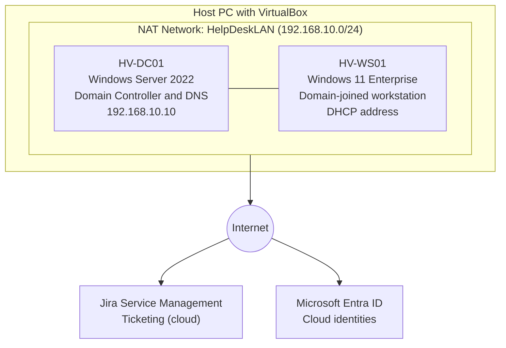

# Simulated Help Desk Environment

A free, low-resource home lab that recreates the environment a Tier 1 help desk technician supports every day: an Active Directory domain, a domain-joined Windows 11 workstation, a ticketing system, and a cloud identity tenant.

**[Start the walkthrough: Simulated-Help-Desk-Environment.md](Simulated-Help-Desk-Environment.md)**

| | |
|---|---|
| **Cost** | $0 (all software is free or a free evaluation) |
| **Skill level** | Beginner |
| **Estimated time** | 3 to 4 hours |
| **Host requirements** | 8+ GB RAM free for VMs, 4+ CPU cores, 110 GB free disk |

---

## Overview

**Harborview Financial Services** is a fictional financial-services firm with about 25 employees in one office. The company has no IT staff. This lab builds the support environment a new Tier 1 help desk technician would set up before the first employee ticket arrives.

Both virtual machines together use 6 GB of RAM and 4 vCPUs, so the lab runs on a typical 16 GB laptop or desktop.

## What You Build



| Component | Name | Details |
|---|---|---|
| Domain controller | `HV-DC01` | Windows Server 2022 Standard Evaluation (Desktop Experience), 2 vCPU, 2 GB RAM, 40 GB disk, static IP `192.168.10.10` |
| Workstation | `HV-WS01` | Windows 11 Enterprise Evaluation, 2 vCPU, 4 GB RAM, 64 GB disk, joined to `harborview.local` |
| Ticketing | `harborview-helpdesk` | Jira Service Management Free plan with 7 request types and a priority table |
| Cloud identity | Default tenant | Microsoft Entra ID Free tenant included with a free Azure account, security defaults confirmed |

## Walkthrough Steps

| Step | What you do |
|---|---|
| [A1](Simulated-Help-Desk-Environment.md#a1-install-windows-server-2022-in-virtualbox) | Install Windows Server 2022 in VirtualBox and set a static IP address |
| [A2](Simulated-Help-Desk-Environment.md#a2-promote-the-server-to-a-domain-controller) | Promote the server to a domain controller and create `harborview.local` |
| [A3](Simulated-Help-Desk-Environment.md#a3-build-a-windows-11-workstation-and-join-the-domain) | Build a Windows 11 Enterprise workstation and join it to the domain |
| [A4](Simulated-Help-Desk-Environment.md#a4-create-the-ticketing-system-jira-service-management) | Create a Jira Service Management service desk with request types and priority rules |
| [A5](Simulated-Help-Desk-Environment.md#a5-set-up-the-microsoft-entra-id-tenant) | Confirm the Microsoft Entra ID Free tenant and its security defaults |

The walkthrough also includes a lab reference card, a completion checklist, a troubleshooting table, and an evaluation expiry reference.

## Skills Demonstrated

- Building and configuring virtual machines in VirtualBox, including a NAT Network and snapshots
- Installing Windows Server 2022 and assigning a static IP address
- Configuring Active Directory Domain Services and DNS, including a DNS forwarder
- Joining a Windows 11 workstation to an Active Directory domain
- Setting up a service desk with request types (categories) and a priority scheme
- Reviewing a Microsoft Entra ID tenant and verifying security defaults
- Verifying each step with commands such as `ipconfig`, `nslookup`, and `Get-ADDomain`
- Writing clear, step-by-step technical documentation

## Requirements

**Software (all free):**

- Oracle VirtualBox 7.0 or later
- Windows Server 2022 evaluation ISO (180-day evaluation)
- Windows 11 Enterprise evaluation ISO (90-day evaluation)

**Accounts (all free):**

- A Microsoft account with a free Azure account
- An Atlassian account for the Jira Service Management Free plan

Download links and exact ISO selections are in the [Prerequisites](Simulated-Help-Desk-Environment.md#prerequisites) section of the walkthrough.

## Repository Contents

```
.
├── README.md                              This overview
├── Simulated-Help-Desk-Environment.md     Full step-by-step walkthrough
├── progress-cheklist.md                   Verification checklist from walkthrough
└── screenshots/                           Screenshots used by the walkthrough
```

## Notes

- **Evaluation licenses expire.** The Windows Server evaluation lasts 180 days and the Windows 11 Enterprise evaluation lasts 90 days. Rebuild the VM from a new evaluation ISO when one expires.
- **No new Entra tenant is created.** Microsoft allows only paid customers to create additional workforce tenants, so the lab uses the tenant that comes with a free Azure account.
- **Keep secrets out of the repository.** Do not commit passwords, and blur or crop email addresses and tenant IDs in screenshots.
- **Everything is fictional.** All company names, domains, and accounts in this lab are made up.

## Planned Next

Practice tasks that build on this environment:

- **Accounts:** create users, reset passwords, unlock accounts, reset MFA
- **Ticket handling:** log, categorize, prioritize, and close a ticket for every exercise
- **Connectivity:** `ipconfig`, `ping`, `nslookup`, `tracert`, and DNS and IP troubleshooting
- **Application and OS issues:** updates, reinstalls, `sfc /scannow`, and profile problems
- **Peripherals:** printers, the print spooler, and USB devices

---

*Windows, Microsoft Entra, Jira, and VirtualBox are trademarks of their respective owners.*
