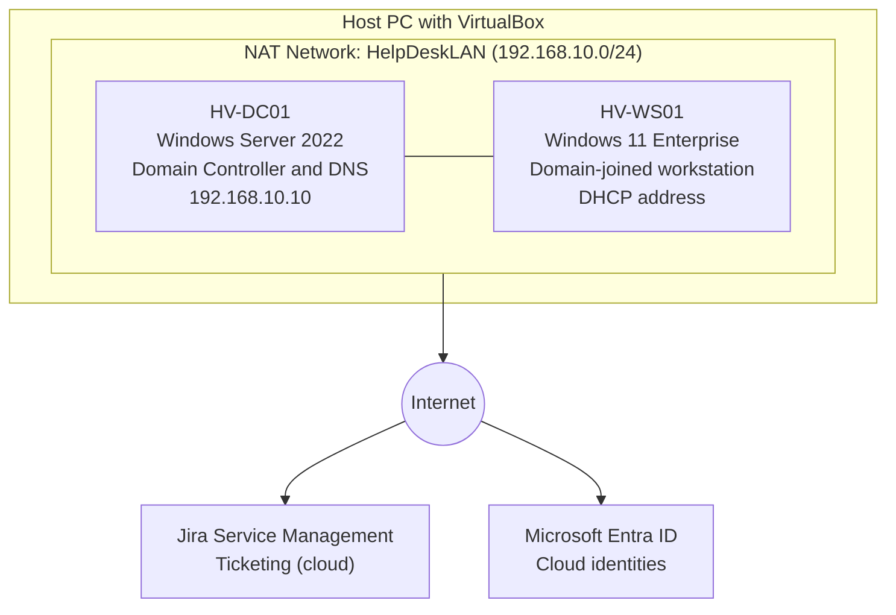

# Simulated Help Desk Environment

A free, low-resource, beginner-friendly home lab that recreates the environment a Tier 1 help desk technician supports every day: an Active Directory domain, a domain-joined Windows 11 workstation, a ticketing system, and a cloud identity tenant.

| | |
|---|---|
| **Cost** | $0 (all software is free or a free evaluation) |
| **Skill level** | Beginner |
| **Estimated time** | 3 to 4 hours |
| **Host requirements** | 8+ GB RAM free for VMs, 4+ CPU cores, 110 GB free disk |

---

## Table of Contents

1. [Scenario](#scenario)
2. [Lab Objectives](#lab-objectives)
3. [Architecture](#architecture)
4. [Prerequisites](#prerequisites)
5. [Lab Reference Card](#lab-reference-card)
6. [A1: Install Windows Server 2022 in VirtualBox](#a1-install-windows-server-2022-in-virtualbox)
7. [A2: Promote the Server to a Domain Controller](#a2-promote-the-server-to-a-domain-controller)
8. [A3: Build a Windows 11 Workstation and Join the Domain](#a3-build-a-windows-11-workstation-and-join-the-domain)
9. [A4: Create the Ticketing System (Jira Service Management)](#a4-create-the-ticketing-system-jira-service-management)
10. [A5: Set Up the Microsoft Entra ID Tenant](#a5-set-up-the-microsoft-entra-id-tenant)
11. [Lab Completion Checklist](#lab-completion-checklist)
12. [Troubleshooting](#troubleshooting)
13. [Good Habits for a Low-Resource Lab](#good-habits-for-a-low-resource-lab)
14. [Evaluation Expiry Reference](#evaluation-expiry-reference)
15. [What Comes Next](#what-comes-next)

> **Screenshots:** Every `` line in this guide is a placeholder. Create an `images/` folder next to this file, save your screenshots with the file names shown, and GitHub will display them. Blur or crop any password, email address, or tenant ID before you commit a screenshot.

> **Menu names change:** Microsoft, Atlassian, and Oracle rename menus and move buttons often. If a label in this guide does not match your screen, find the closest match in the same area.

---

## Scenario

**Harborview Financial Services** is a fictional financial-services firm with about 25 employees in one office. The company has no IT staff. You are the new Tier 1 help desk technician, and your first assignment is to build the support environment before the first employee ticket arrives.

The environment has four parts:

1. A **Windows Server 2022 domain controller** that runs the company's Active Directory domain, `harborview.local`.
2. A **Windows 11 Enterprise workstation** joined to that domain, representing an employee's computer.
3. A **Jira Service Management** service desk where employee issues are logged, categorized, and prioritized.
4. A **Microsoft Entra ID tenant** for cloud account tasks such as MFA resets.

All company names, domains, and accounts in this guide are fictional.

## Lab Objectives

By the end of this lab you will have:

- Installed Windows Server 2022 in VirtualBox and given it a static IP address.
- Created an Active Directory domain with DNS.
- Built a Windows 11 workstation and joined it to the domain.
- Created a free service desk with request types (categories) and priority rules.
- Confirmed the free Microsoft Entra ID tenant included with your Azure account and verified its security defaults.

## Architecture



| VM | Hostname | Operating system | vCPU | RAM | Disk (max, grows as used) | Network address |
|---|---|---|---|---|---|---|
| Domain controller | `HV-DC01` | Windows Server 2022 Standard Evaluation (Desktop Experience) | 2 | 2 GB | 40 GB | `192.168.10.10` (static) |
| Workstation | `HV-WS01` | Windows 11 Enterprise Evaluation | 2 | 4 GB | 64 GB | DHCP from VirtualBox |

**Resource budget:** Both VMs together use 6 GB of RAM and 4 vCPUs. On a host with 16 GB of RAM and 8 cores, that leaves 10 GB of RAM and 4 cores for your host operating system.

The Active Directory domain and the Entra ID tenant are separate in this lab. No synchronization is configured between them.

## Prerequisites

**Software (all free):**

- Oracle VirtualBox 7.0 or later: <https://www.virtualbox.org/wiki/Downloads>. Version 7 or later is required because it adds the TPM 2.0 and Secure Boot support that Windows 11 needs.
- Windows Server 2022 evaluation ISO (180-day evaluation): <https://www.microsoft.com/en-us/evalcenter/evaluate-windows-server-2022>. Select **Windows Server 2022 | 64-bit ISO**, then register to download.
- Windows 11 Enterprise evaluation ISO (90-day evaluation): <https://www.microsoft.com/en-us/evalcenter/evaluate-windows-11-enterprise>. Select the standard **Windows 11 Enterprise x64 ISO**, not the LTSC version, then register to download.

**Accounts (all free):**

- A Microsoft account with a free Azure account (used in A5).
- An email address for a free Atlassian account (used in A4).

## Lab Reference Card

Use these exact values throughout the guide. Record the passwords in a password manager. Never commit a password to GitHub.

| Item | Value |
|---|---|
| Company | Harborview Financial Services |
| Active Directory domain | `harborview.local` |
| NetBIOS (short) domain name | `HARBORVIEW` |
| Domain controller hostname | `HV-DC01` |
| Domain controller IP address | `192.168.10.10` |
| Subnet mask | `255.255.255.0` |
| Workstation hostname | `HV-WS01` |
| VirtualBox NAT network name | `HelpDeskLAN` |
| NAT network address range | `192.168.10.0/24` |
| Domain administrator sign-in | `HARBORVIEW\Administrator` |
| Workstation local setup account | `labadmin` |
| Jira site name | `harborview-helpdesk` |
| Jira space name and key | Harborview IT Help Desk, `HELP` |
| Entra tenant | Your Azure account's default tenant (usually Default Directory) |

---

## A1: Install Windows Server 2022 in VirtualBox

**Goal:** A running Windows Server 2022 VM named `HV-DC01` with a static IP address on the `HelpDeskLAN` network.

### A1.1 Create the VirtualBox NAT network

A NAT Network lets both VMs talk to each other and reach the internet through one shared network.

1. Open VirtualBox.
2. Open **File > Tools > Network Manager**. (In newer versions, select **Tools** in the left sidebar, then **Network**.)
3. Select the **NAT Networks** tab and click **Create**.
4. Select the new network and set:
   - **Name:** `HelpDeskLAN`
   - **IPv4 Prefix:** `192.168.10.0/24`
   - **Enable DHCP:** checked
5. Click **Apply**.


### A1.2 Create the VM

1. In VirtualBox, click **New**.
2. Set:
   - **Name:** `HV-DC01`
   - **ISO Image:** select the Windows Server 2022 evaluation ISO
   - **Type:** Microsoft Windows
   - **Version:** Windows 2022 (64-bit)
   - **Skip Unattended Installation:** checked
3. Click **Next**. Set **Base Memory** to `2048` MB and **Processors** to `2`.
4. Click **Next**. Select **Create a Virtual Hard Disk Now**, set the size to `40` GB, and leave **Pre-Allocate Full Size** unchecked.
5. Click **Finish**.
6. Select `HV-DC01`, click **Settings > Network**, and set **Adapter 1**:
   - **Attached to:** NAT Network
   - **Name:** `HelpDeskLAN`
7. Click **OK**.


### A1.3 Install Windows Server

1. Select `HV-DC01` and click **Start**.
2. When the screen says **Press any key to boot from CD or DVD**, press a key.
3. On the Windows Setup screen, keep the language defaults, click **Next**, then click **Install now**.
4. Select **Windows Server 2022 Standard Evaluation (Desktop Experience)** and click **Next**. Do not select an option without "(Desktop Experience)". Those options have no graphical interface.
5. Accept the license terms and click **Next**.
6. Select **Custom: Install Microsoft Server Operating System only**.
7. Select the 40 GB unallocated drive and click **Next**. Setup installs and restarts the VM on its own.
8. When the VM restarts and shows **Press any key to boot from CD or DVD** again, do not press a key. Let it time out so the VM boots from the new installation.
9. On **Customize settings**, set the local **Administrator** password. Record it. Click **Finish**.
10. To sign in, click **Input > Keyboard > Insert Ctrl-Alt-Del** in the VM window menu, then enter the Administrator password.


### A1.4 Install VirtualBox Guest Additions

Guest Additions improve screen resizing, mouse movement, and performance.

1. In the VM window menu, click **Devices > Insert Guest Additions CD image**.
2. In the VM, open **File Explorer > This PC** and open the **CD Drive (VirtualBox Guest Additions)**.
3. Run `VBoxWindowsAdditions.exe`. Click **Next** through the defaults and click **Install**.
4. Select **Reboot now** and click **Finish**.

### A1.5 Rename the server

1. In **Server Manager**, click **Local Server**.
2. Click the **Computer name** (it starts with `WIN-`).
3. Click **Change...**, set **Computer name** to `HV-DC01`, and click **OK**.
4. Click **OK** again, close the window, and click **Restart Now**.

### A1.6 Set a static IP address

A domain controller must keep the same IP address, so you assign it manually.

1. Sign in again. Open **Command Prompt** (Start menu, type `cmd`, press Enter).
2. Run:
   ```
   ipconfig /all
   ```
3. Find **Default Gateway** in the output and write the address down. You need it in step 6.
4. Press **Win + R**, type `ncpa.cpl`, and press Enter.
5. Right-click **Ethernet**, click **Properties**, select **Internet Protocol Version 4 (TCP/IPv4)**, and click **Properties**.
6. Select **Use the following IP address** and enter:
   - **IP address:** `192.168.10.10`
   - **Subnet mask:** `255.255.255.0`
   - **Default gateway:** the address you wrote down in step 3
7. Select **Use the following DNS server addresses** and enter:
   - **Preferred DNS server:** `192.168.10.10`
   - **Alternate DNS server:** leave blank
8. Click **OK**, then click **Close**.


### A1 Verification

- [ ] `ipconfig /all` shows `HV-DC01`, IPv4 address `192.168.10.10`, and the default gateway you entered.
- [ ] `ping 8.8.8.8` gets replies.
- [ ] `slmgr /dlv` opens a dialog that lists the remaining evaluation time (about 180 days).

`ping google.com` fails at this point. This is expected because DNS is not installed until A2.

### A1 Snapshot

In the VirtualBox window, select `HV-DC01`, click **Snapshots**, and click **Take**. Name it `A1-clean-install`. A snapshot lets you roll back if a later step goes wrong.

---

## A2: Promote the Server to a Domain Controller

**Goal:** `HV-DC01` runs Active Directory Domain Services and DNS for the domain `harborview.local`.

### A2.1 Install the Active Directory Domain Services role

1. In **Server Manager**, click **Manage > Add Roles and Features**.
2. Click **Next** on **Before You Begin**, **Installation Type** (keep **Role-based or feature-based installation**), and **Server Selection** (keep `HV-DC01`).
3. On **Server Roles**, check **Active Directory Domain Services**. Click **Add Features** in the pop-up, then click **Next**.
4. Click **Next** through **Features**, **AD DS**, and **Confirmation**.
5. Click **Install**. When it finishes, click **Close**.

### A2.2 Promote the server

1. In **Server Manager**, click the yellow warning flag at the top, then click **Promote this server to a domain controller**.
2. On **Deployment Configuration**, select **Add a new forest** and enter **Root domain name:** `harborview.local`. Click **Next**.
3. On **Domain Controller Options**, keep the default functional levels. Keep **Domain Name System (DNS) server** and **Global Catalog (GC)** checked. Set a **Directory Services Restore Mode (DSRM) password** and record it. Click **Next**.
4. On **DNS Options**, a warning says **A delegation for this DNS server cannot be created**. This is expected in a lab. Click **Next**.
5. On **Additional Options**, confirm the **NetBIOS domain name** is `HARBORVIEW`. Click **Next**.
6. On **Paths**, keep the defaults. Click **Next**.
7. On **Review Options**, click **Next**.
8. On **Prerequisites Check**, warnings are acceptable. Errors must be fixed before you continue. Click **Install**.
9. The VM restarts on its own.
10. Sign in as `HARBORVIEW\Administrator` with the Administrator password from A1.3.


### A2.3 Add a DNS forwarder

A forwarder sends DNS questions the domain controller cannot answer (such as `google.com`) to a public DNS server.

1. In **Server Manager**, click **Tools > DNS**.
2. Right-click `HV-DC01` and click **Properties**.
3. Open the **Forwarders** tab and click **Edit...**.
4. Type `8.8.8.8`, press Enter, and click **OK**. Click **OK** again.

### A2 Verification

Open **PowerShell** and run each command:

```powershell
Get-ADDomain | Select-Object DNSRoot, NetBIOSName
```

Expected: `DNSRoot` is `harborview.local` and `NetBIOSName` is `HARBORVIEW`.

```powershell
nslookup harborview.local
```

Expected: the answer includes `192.168.10.10`.

```powershell
nslookup google.com
```

Expected: an IP address is returned.

- [ ] **Server Manager** shows **AD DS** and **DNS** with green status.
- [ ] **Tools > Active Directory Users and Computers** opens, and **Domain Controllers** contains `HV-DC01`.


### A2 Snapshot

Take a snapshot named `A2-domain-controller`. Keep `HV-DC01` running for A3.

---

## A3: Build a Windows 11 Workstation and Join the Domain

**Goal:** A Windows 11 Enterprise VM named `HV-WS01` that is joined to `harborview.local`.

### A3.1 Create the VM

1. In VirtualBox, click **New**.
2. Set:
   - **Name:** `HV-WS01`
   - **ISO Image:** select the Windows 11 Enterprise evaluation ISO
   - **Type:** Microsoft Windows
   - **Version:** Windows 11 (64-bit)
   - **Skip Unattended Installation:** checked
3. Click **Next**. Set **Base Memory** to `4096` MB and **Processors** to `2`.
4. Click **Next**. Select **Create a Virtual Hard Disk Now**, set the size to `64` GB, and leave **Pre-Allocate Full Size** unchecked.
5. Click **Finish**.
6. Select `HV-WS01` and click **Settings > System > Motherboard**. Confirm all three of these:
   - **Enable EFI (special OSes only)** is checked.
   - **TPM** is set to `v2.0`.
   - **Enable Secure Boot** is checked.

   VirtualBox usually sets these for Windows 11 automatically. Windows 11 setup refuses to continue without them.
7. Click **Network** and set **Adapter 1**:
   - **Attached to:** NAT Network
   - **Name:** `HelpDeskLAN`
8. Click **OK**.


### A3.2 Install Windows 11 Enterprise

1. Click **Start**. When the screen says **Press any key to boot from CD or DVD**, press a key.
2. Keep the language defaults, click **Next**, and click **Install now**.
3. Select **I don't have a product key**.
4. Select **Windows 11 Enterprise** and click **Next**.
5. Accept the license terms.
6. Select **Custom: Install Windows only (advanced)**, select the 64 GB drive, and click **Next**.
7. When the VM restarts and shows **Press any key to boot from CD or DVD** again, do not press a key.
8. Complete the first-run setup: choose your region and keyboard layout, and skip the second keyboard layout.
9. On **Let's set things up for your work or school**, click **Sign-in options**, then click **Domain join instead**.
10. Create the local account `labadmin`, set a password, and record it. Answer any security questions, then decline optional privacy and feature prompts.


### A3.3 Install VirtualBox Guest Additions

1. In the VM window menu, click **Devices > Insert Guest Additions CD image**.
2. Open **File Explorer > This PC > CD Drive (VirtualBox Guest Additions)** and run `VBoxWindowsAdditions.exe`.
3. Click **Next** through the defaults, click **Install**, and select **Reboot now**.

### A3.4 Point the workstation at the domain controller's DNS

The workstation finds the domain through DNS, so its DNS server must be the domain controller.

1. Press **Win + R**, type `ncpa.cpl`, and press Enter.
2. Right-click **Ethernet**, click **Properties**, select **Internet Protocol Version 4 (TCP/IPv4)**, and click **Properties**.
3. Keep **Obtain an IP address automatically** selected.
4. Select **Use the following DNS server addresses** and enter:
   - **Preferred DNS server:** `192.168.10.10`
   - **Alternate DNS server:** leave blank
5. Click **OK**, then click **Close**.
6. Open **Command Prompt** and run each command:
   ```
   ipconfig /all
   ping 192.168.10.10
   nslookup harborview.local
   ```

Expected: an IPv4 address in the `192.168.10.x` range, replies from `192.168.10.10`, and `nslookup` returns `192.168.10.10`. Do not continue until all three work.

### A3.5 Join the domain

1. Press **Win + R**, type `sysdm.cpl`, and press Enter.
2. On the **Computer Name** tab, click **Change...**.
3. Set **Computer name** to `HV-WS01`.
4. Under **Member of**, select **Domain** and enter `harborview.local`. Click **OK**.
5. When prompted for credentials, enter `HARBORVIEW\Administrator` and the domain Administrator password.
6. A message says **Welcome to the harborview.local domain**. Click **OK** and restart the VM.
7. At the sign-in screen, click **Other user** and sign in as `HARBORVIEW\Administrator`.


### A3 Verification

On `HV-WS01`, open **Command Prompt** and run:

```
echo %USERDOMAIN%
whoami
```

Expected: `HARBORVIEW` and `harborview\administrator`.

On `HV-DC01`:

- [ ] **Tools > Active Directory Users and Computers > harborview.local > Computers** lists `HV-WS01`.


### A3 Snapshot

Take a snapshot of `HV-WS01` named `A3-domain-joined`.

---

## A4: Create the Ticketing System (Jira Service Management)

**Goal:** A free Jira Service Management site with a service desk space, request types (categories), and priority rules.

The Free plan supports up to 3 agents with unlimited customers and has no time limit. This lab uses 1 agent (you). Atlassian can deactivate a Free site after 120 days of inactivity, so sign in at least once every few months.

### A4.1 Sign up and create the site

1. Open <https://www.atlassian.com/software/jira/service-desk/pricing?tab=cloud>.
2. Select the sign-up button in the **Free** column.
3. Sign up with your email address (or a Google, Microsoft, or Apple account) and verify your email.
4. When asked to name your site, enter `harborview-helpdesk`. If the name is taken, add numbers to the end. The site address becomes `https://harborview-helpdesk.atlassian.net`.
5. Select **Jira Service Management** as the product and confirm the **Free** plan. No credit card is required. Skip any prompt to invite teammates.


### A4.2 Create the service desk space

1. In Jira Service Management, create a new space (called a *project* in older versions).
2. Select the **IT service management** template and click **Use template**.
3. Set:
   - **Name:** `Harborview IT Help Desk`
   - **Key:** `HELP`
4. Accept the defaults for all other options and create the space.

### A4.3 (Step C1) Create request types

Request types are the categories employees choose from when they ask for help. Each one maps to a Tier 1 task area.

1. Open the space and select **Space settings** (called *Project settings* in older versions), then **Request types**.
2. Leave the default request types in place.
3. Click **Create request type** and add each row below. Use the **Name** exactly as written and select the **Issue type** shown.

| Name | Issue type | Used for |
|---|---|---|
| Password / Account Access | Service request | Password resets, account unlocks, MFA resets |
| Network & Connectivity | Incident | Wi-Fi, VPN, DNS, DHCP problems |
| Software & OS Issue | Incident | Office, Teams, updates, slow computers |
| Hardware & Peripherals | Incident | Printers, docks, monitors, headsets |
| Access Request | Service request | Shared drives, groups, application access |
| Onboarding / Offboarding | Service request | New-hire and leaver account setup |
| Report a Security Concern | Incident | Phishing, suspected compromise, malware |


### A4.4 (Step C1) Define priority rules

Jira already includes the priority levels **Highest, High, Medium, Low, Lowest**. Do not rename them. Apply this table as your lab's rules, and set the **Priority** field on every ticket you work.

| Jira priority | Label | When to use it | Expected response |
|---|---|---|---|
| Highest | P1 | Outage affecting many users, or a confirmed security incident | Immediate; escalate right away |
| High | P2 | One user is completely blocked and has no workaround | Within 1 hour |
| Medium | P3 | One user is impaired but has a workaround | Within 4 hours |
| Low | P4 | Minor issue, how-to question, or request with no deadline | Within 1 business day |
| Lowest | None | Not used in this lab | Not applicable |

### A4 Verification

1. Open the customer portal for the space (find the portal link in **Space settings** or the space's **Customer view**).
2. Confirm all 7 new request types appear on the portal.
3. Select **Password / Account Access** and submit a request with the summary `TEST - lab setup`.
4. In the agent view, open the queue of open requests and confirm `TEST - lab setup` appears with the request type shown.
5. Open the ticket and set **Priority** to **Medium**.
6. Leave the ticket open. It becomes your first practice ticket.


---

## A5: Set Up the Microsoft Entra ID Tenant

**Goal:** Confirm the Microsoft Entra ID Free tenant that comes with your Azure account, and confirm that security defaults are enabled.

> **Why this lab does not create a new tenant:** Microsoft allows only paid customers to create additional workforce tenants. Accounts on a free tenant or a trial subscription cannot create them. The **External** tenant option is for customer-facing apps, not employee accounts, so it does not fit this lab. This lab uses the tenant your free Azure account already includes.

> **This is your real Azure tenant.** Do not rename it, delete anything in it, or turn off security defaults. In later practice tasks, create only test users with a clear prefix, such as `hv.testuser1`.

### A5.1 Open the tenant

1. Open <https://entra.microsoft.com> and sign in with your Azure account.
2. Select **Entra ID > Overview**.
3. Confirm the tenant name at the top of the page. For a new free Azure account it is usually **Default Directory**.


### A5.2 Confirm the license

1. On the **Overview** page, find the tenant's license in the tenant details near the top.
2. Confirm it says **Microsoft Entra ID Free**.

### A5.3 Confirm security defaults

Security defaults are Microsoft's free baseline protection. They require all users to register for MFA, which you need for the MFA reset practice task later.

1. Select **Entra ID > Overview > Properties**.
2. Click **Manage security defaults**.
3. Confirm **Security defaults** is set to **Enabled**. If it is not, set it to **Enabled** and click **Save**.


### A5 Verification

- [ ] **Entra ID > Overview** shows the tenant name and the license **Microsoft Entra ID Free**.
- [ ] **Entra ID > Users** lists your administrator account.
- [ ] **Properties > Manage security defaults** shows **Enabled**.

---

## Lab Completion Checklist

- [ ] `HV-DC01` runs Windows Server 2022 with static IP `192.168.10.10`.
- [ ] Domain `harborview.local` exists, and DNS resolves both internal and internet names.
- [ ] `HV-WS01` runs Windows 11 Enterprise and shows in the **Computers** container.
- [ ] Jira Service Management has 7 new request types and the priority table is defined.
- [ ] A test ticket exists with Priority set to Medium.
- [ ] The Entra ID Free tenant is confirmed, and security defaults are enabled.
- [ ] Snapshots `A1-clean-install`, `A2-domain-controller`, and `A3-domain-joined` exist.

## Troubleshooting

| Symptom | Cause | Fix |
|---|---|---|
| Windows 11 setup says **This PC can't run Windows 11** | Missing TPM, Secure Boot, RAM, or disk | Power off the VM. In **Settings > System**, confirm TPM `v2.0`, EFI, and Secure Boot are enabled, RAM is 4096 MB or more, 2 or more processors, and the disk is 64 GB or larger. |
| VM has no internet | Wrong network attachment | Power off the VM. In **Settings > Network**, confirm **Attached to** is **NAT Network** with `HelpDeskLAN`. Confirm **Enable DHCP** is checked on the network in Network Manager. |
| `ping 8.8.8.8` fails on the server | Static gateway entered incorrectly, or the host blocks ICMP | Re-run `ipconfig /all` before the static IP was set (or set the adapter back to automatic temporarily) and confirm the gateway value. If the gateway is correct, continue to A2 and test internet access with `nslookup google.com`. |
| Domain join error: **The specified domain either does not exist or could not be contacted** | Workstation is not using the domain controller for DNS | On `HV-WS01`, confirm the DNS server is `192.168.10.10` (A3.4). Confirm `HV-DC01` is running and `nslookup harborview.local` works. |
| Domain sign-in fails | Wrong user format | Enter `HARBORVIEW\Administrator`, not just `Administrator`. |
| **Domain join instead** is missing during Windows 11 setup | Setup requires an account sign-in while online | In the VM window menu, click **Devices > Network > Connect Network Adapter** to disconnect, restart the setup screen, and create a local account. Reconnect the adapter after setup. |
| Prerequisites check shows an **error** during promotion | A real configuration problem | Read the message. The most common cause is a missing static IP or a weak Administrator password. Fix it and run the check again. |
| `slmgr /dlv` shows an expired or not-activated evaluation | The VM could not reach the internet to activate | Confirm internet access from the VM. Evaluation editions must activate online within the first 10 days. |

## Good Habits for a Low-Resource Lab

- Start `HV-DC01` first and wait until you reach the sign-in screen, then start `HV-WS01`.
- Shut down both VMs from inside Windows (**Start > Power > Shut down**) when you finish for the day. Do not close the VirtualBox window while a VM runs.
- Close other heavy applications on the host while both VMs run.
- Take a snapshot before every risky change. Delete old snapshots you no longer need to save disk space.

## Evaluation Expiry Reference

| Item | Free period | What happens afterward |
|---|---|---|
| Windows Server 2022 evaluation | 180 days | Rebuild the VM from a new evaluation ISO. |
| Windows 11 Enterprise evaluation | 90 days | Rebuild the VM from a new evaluation ISO. |
| Jira Service Management Free plan | No time limit | The site can be deactivated after 120 days of inactivity. |
| Microsoft Entra ID Free tenant | No time limit | No action needed. |

Note your build date in your repository so you know when each evaluation expires.

## What Comes Next

This environment supports the Tier 1 practice tasks in the rest of the Simulated Help Desk series:

- **B. Accounts:** create users, reset passwords, unlock accounts, reset MFA.
- **C. Ticket handling:** log, categorize, prioritize, and close a ticket for every exercise.
- **D. Connectivity:** `ipconfig`, `ping`, `nslookup`, `tracert`, and DNS and IP troubleshooting.
- **E. Application and OS issues:** updates, reinstalls, `sfc /scannow`, and profile problems.
- **F. Peripherals:** printers, the print spooler, and USB devices.

---

*All companies, domains, and accounts in this lab are fictional. Windows, Microsoft Entra, Jira, and VirtualBox are trademarks of their respective owners.*
